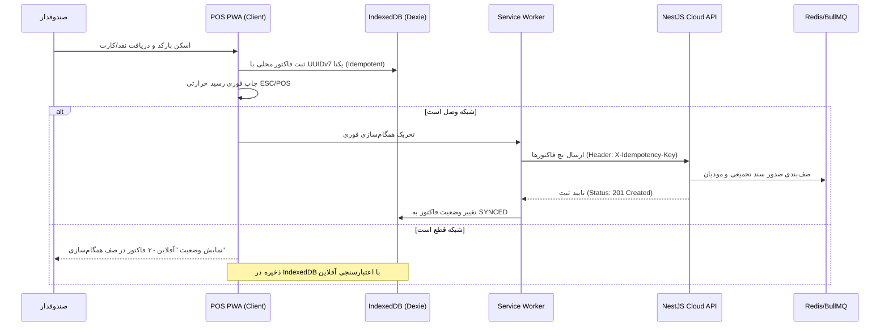

# سند معماری و طراحی جامع پلتفرم حسابداری و مدیریت کسب‌وکار ایرانی (نسخه ۳)
**شامل معماری قفل‌شده، مدل داده ERD، حسابداری دوبل اصناف، UI/UX سیستم طراحی، POS آفلاین و نقشه راه**

---

## ۱. تصمیم‌های معماری ثبت‌شده (Architecture Decision Records - ADRs)

### ADR-001: انتخاب PostgreSQL با Row-Level Security (RLS) برای Multi-tenancy
- **مساله:** نحوه تفکیک داده‌های هزاران شرکت مشترک (Tenants) با حفظ بالاترین درجه امنیت و کارایی.
- **گزینه‌ها:**
  1. *Database-per-tenant:* هزینه بالای نگهداری، دشواری ارتقای ساختار اسکیما برای هزاران شرکت.
  2. *Schema-per-tenant:* پیچیدگی در مدیریت Connection Pool و محدودیت‌های PostgreSQL در اسکیماهای پرتعداد (بالای چند هزار).
  3. *Shared Database with Row-Level Security (RLS):* یک دیتابیس با ستون `tenant_id` روی تمامی جداول و اعمال پالیسی RLS سخت‌گیرانه در سطح هسته دیتابیس به همراه ایندکس‌گذاری ترکیبی.
- **تصمیم:** استفاده از **Shared Database with Row-Level Security (RLS)** به عنوان معماری استاندارد SaaS، با قابلیت استقرار Schema-per-tenant اختصاصی برای مشتریان سازمانی بسیار بزرگ (Enterprise).
- **پیامدها:** تضمین غیرقابل دور زدن تفکیک تنانت‌ها حتی در صورت بروز باگ در کوئری لایه وب؛ نیاز به تست خودکار منظم جهت اطمینان از اعمال `tenant_id` در Context جلسات دیتابیس.

---

### ADR-002: الگوی مونولیت ماژولار مبتنی بر Transactional Outbox و Posting Templates
- **مساله:** تضمین تراز دفاتر مالی، یکپارچگی کامل اسناد مبدا با اسناد دوبل، و مقیاس‌پذیری بدون پیچیدگی و خطاهای شبکه میکروسرویس‌ها.
- **گزینه‌ها:**
  1. *Microservices:* تاخیر بالای شبکه، نیاز به تراکنش‌های توزیع‌شده (Saga/2PC) و خطر ناهمخوانی بین انبار و دفاتر کل.
  2. *Modular Monolith with Transactional Outbox:* تمام ماژول‌ها در یک فرآیند با مرزهای شفاف دامنه (Bounded Contexts) اجرا می‌شوند. هر تغییر تجاری (مثل فروش یا خروج از انبار) در همان تراکنش اتمی دیتابیس، یک رویداد Outbox ایجاد می‌کند که توسط Worker پردازش شده و به قالب سند (Posting Template) نگاشت می‌شود.
- **تصمیم:** **مونولیت ماژولار رویدادمحور با Transactional Outbox**.
- **پیامدها:** عدم امکان تغییر مستقیم مانده حساب‌ها خارج از سرویس اسناد دوبل؛ قابلیت ردیابی دوسویه کامل فاکتور به سند حسابداری و بالعکس؛ سادگی استقرار و مانیتورینگ.

---

### ADR-003: معماری POS آفلاین (PWA + IndexedDB + Idempotent Delta Sync)
- **مساله:** تضمین کارکرد ۱۰۰٪ پایدار صندوق فروشگاه و رستوران حتی در زمان قطعی کامل اینترنت بدون ایجاد اسناد تکراری یا تعارض در موجودی.
- **گزینه‌ها:**
  1. *برنامه وابسته به شبکه (Online-only):* غیرقابل قبول در محیط فروشگاهی به دلیل قطع و وصلی مکرر شبکه.
  2. *PWA با IndexedDB (Dexie) و صف همگام‌سازی محلی:* کاتالوگ، لیست قیمت و مشتریان در مرورگر کش می‌شود. فاکتورها با کلید شناسه کلاینت یکتا (ULID/UUIDv7) در صف محلی ثبت و به محض اتصال ارسال می‌شوند.
- **تصمیم:** پیاده‌سازی PWA آفلاین با موتور همگام‌سازی تفاضلی (Delta Sync) و ارسال فاکتورها با سربرگ Idempotency.
- **پیامدها:** امکان صدور نامحدود فاکتور آفلاین؛ قوانین شفاف حل تعارض در سرور؛ چاپ مستقیم از طریق درایور وب و پل چاپگر محلی (Print Bridge).

---

### ADR-004: دقت محاسبات پولی و سیاست‌های گرد کردن
- **مساله:** خطاهای گرد کردن ممیز شناور (IEEE 754 float) در محاسبات مالیاتی و ارزیابی انبار.
- **تصمیم:**
  1. در پایگاه داده: ذخیره مبالغ به صورت `BIGINT` بر مبنای کوچکترین واحد رسمی کشور (ریال). برای قیمت‌های ارزی و اوزان دقیق کالا (مانند طلا و گرم) استفاده از `NUMERIC(24, 6)`.
  2. در هسته محاسباتی: استفاده انحصاری از کتابخانه `Decimal.js` با دقت ۲۸ رقمی اعشار و سیاست گرد کردن بانکی (`ROUND_HALF_UP`).
  3. تبدیل تومان: صرفاً در لایه ورودی و نمایش به کاربر، بدون ذخیره تومان در هسته دیتابیس.

---

### ADR-005: ساختار مخزن مونو-ریپو و استقلال لایه دامنه (`packages/domain`)
- **مساله:** جلوگیری از وابستگی منطق حسابداری و محاسبات مالیاتی به فریمورک‌ها (NestJS / React) و پایگاه داده.
- **تصمیم:** جداسازی کامل قوانین حسابداری، مالیات، حقوق، استهلاک و مودیان در بسته `packages/domain` به صورت توابع خالص (Pure TypeScript) با پوشش تست ۱۰۰٪؛ اشتراک تایپ‌ها و اسکیمای اعتبارسنجی Zod در `packages/shared`.
- **پیامدها:** امکان اجرای منطق اعتبارسنجی یکسان در مرورگر کاربر و بکاند؛ سرعت بالای تست‌های واحد دامنه‌ای بدون نیاز به دیتابیس یا سرور تست.

---

### ADR-006: ماژول مودیان در Worker ایزوله با الگوی Transport Adapter
- **مساله:** امضای دیجیتال JWS، حفاظت از کلیدهای خصوصی RSA 2048-bit و ترافیک بالای صف ارسال مودیان بدون کند کردن هسته تراکنشی.
- **تصمیم:** پیاده‌سازی موتور مودیان در قالب Worker پردازشی اختصاصی (`apps/worker`) و ارتباط با سامانه مودیان از طریق Adapter چندحالته (ارسال مستقیم مودی، شرکت معتمد، محیط آزمایشی Sandbox).

---

## ۲. مدل داده جامع ERD (پوشش کامل ۳۶ موجودیت الزامی)

```mermaid
erDiagram
    TENANT ||--o{ COMPANY : owns
    TENANT ||--o{ USER : contains
    COMPANY ||--o{ BRANCH : operates
    COMPANY ||--o{ FISCAL_YEAR : defines
    COMPANY ||--o{ ACCOUNT_HEAD : structures
    ACCOUNT_HEAD ||--o{ ACCOUNT_SUBSIDIARY : breaks_down
    COMPANY ||--o{ FLOATING_DIMENSION : tracks
    
    COMPANY ||--o{ JOURNAL_ENTRY : records
    JOURNAL_ENTRY ||--|{ JOURNAL_LINE : contains
    JOURNAL_LINE }o--|| ACCOUNT_SUBSIDIARY : posts_to
    JOURNAL_LINE }o--o| FLOATING_DIMENSION : references_dim1
    JOURNAL_LINE }o--o| FLOATING_DIMENSION : references_dim2
    
    COMPANY ||--o{ PARTY : interacts
    PARTY ||--o| FLOATING_DIMENSION : maps_to
    
    COMPANY ||--o{ WAREHOUSE : manages
    COMPANY ||--o{ PRODUCT : catalogs
    PRODUCT ||--o{ PRODUCT_VARIANT : has
    PRODUCT ||--o{ STOCK_LEDGER_ENTRY : traces
    WAREHOUSE ||--o{ STOCK_LEDGER_ENTRY : holds
    
    COMPANY ||--o{ SALES_DOCUMENT : issues
    SALES_DOCUMENT ||--|{ SALES_DOCUMENT_LINE : details
    SALES_DOCUMENT ||--o| JOURNAL_ENTRY : generates_voucher
    
    COMPANY ||--o{ PURCHASE_DOCUMENT : receives
    PURCHASE_DOCUMENT ||--|{ PURCHASE_DOCUMENT_LINE : details
    PURCHASE_DOCUMENT ||--o| JOURNAL_ENTRY : generates_voucher
    
    COMPANY ||--o{ CHEQUE : tracks
    COMPANY ||--o{ BANK_ACCOUNT : operates
    CHEQUE }o--o| BANK_ACCOUNT : clears_through
    
    COMPANY ||--o{ RECIPE_BOM : defines
    RECIPE_BOM ||--|{ RECIPE_BOM_LINE : consumes
    COMPANY ||--o{ PRODUCTION_ORDER : executes
    
    BRANCH ||--o{ DINING_TABLE : places
    DINING_TABLE ||--o{ RESTAURANT_ORDER : hosts
    RESTAURANT_ORDER ||--|{ RESTAURANT_ORDER_LINE : contains
    RESTAURANT_ORDER ||--o{ KDS_TICKET : routes_to
    
    BRANCH ||--o{ POS_SHIFT : operates
    POS_SHIFT ||--o{ CASH_MOVEMENT : logs
    
    COMPANY ||--o{ EMPLOYEE : employs
    EMPLOYEE ||--o{ PAYROLL_SLIP : receives
    
    COMPANY ||--o{ FIXED_ASSET : owns
    FIXED_ASSET ||--o{ FIXED_ASSET_DEPRECIATION : depreciates
    
    COMPANY ||--o{ MOADIAN_INVOICE : transmits
    MOADIAN_INVOICE ||--o{ MOADIAN_OUTBOX : queues
    
    COMPANY ||--o{ AUDIT_LOG : secures_chain
    TENANT ||--o{ TENANT_SUBSCRIPTION : subscribes
```



### شرح ساختار جداول کلیدی:

1. **`tenants` & `companies` & `branches`**:
   - تفکیک هلدینگ، شرکت‌های زیرمجموعه و شعب توزیع‌شده با فیلدهای شناسایی کد پستی، شناسه ملی، کد اقتصادی و ارز پایه.
2. **`account_groups`, `account_heads`, `account_subsidiaries`, `floating_dimensions`**:
   - کدینگ استاندارد حسابداری در ۴ سطح سلسله‌مراتبی و ۴ بعد تفصیلی شناور مستقل (اشخاص، بانک‌ها، مراکز هزینه، پروژه‌ها).
3. **`journal_entries` & `journal_lines`**:
   - سرفصل اسناد حسابداری دوبل با وضعیت‌های `DRAFT`, `APPROVED`, `PERMANENT` و ثبت ردیف‌های بدهکار و بستانکار، ارجاع به سند مبدا (`source_module`, `source_document_id`) و زنجیره ممیزی ضدجعل.
4. **`stock_ledger_entries` (کاردکس مقداری-ریالی انبار)**:
   - ردیابی ریز گردش ورودی و خروجی انبار بر اساس نرخ میانگین متحرک یا FIFO با قفل همزمانی.
5. **`moadian_invoices` & `moadian_outbox`**:
   - شناسه منحصر‌به‌فرد مالیاتی ۲۲ کاراکتری، امضای دیجیتال JWS، جدول وضعیت ارسال و صف Outbox با قابلیت ارسال مجدد هوشمند.
6. **`audit_logs` (زنجیره ممیزی هش SHA-256)**:
   - ذخیره هش رکورد قبلی (`prev_hash`) و هش جاری (`current_hash`) برای تضمین غیرقابل دستکاری بودن تمامی رخدادهای مالی و امنیتی.

---

## ۳. قالب‌های کسب‌وکار و سرفصل‌های پیش‌فرض حسابداری (Business Presets)

### ۳.۱. قالب رستوران، کافه و صنایع غذایی
- **حساب‌های تخصصی**:
  - `۱۵۰۶`: موجودی مواد اولیه و پروتئینی انبار سردخانه
  - `۱۵۰۷`: موجودی نوشیدنی‌ها و اقلام بار سرد
  - `۶۱۰۶`: درآمد فروش سالن، دلیوری و بیرون‌بر
  - `۶۱۰۸`: درآمد حق سرویس و انعام
  - `۱۱۰۶`: حساب واسط مطالبات از پلتفرم‌های آنلاین (اسنپ‌فود، تپسی‌فود)
  - `۷۱۰۳`: بهای تمام شده مواد اولیه مصرفی غذا (Food Cost)
  - `۷۱۰۴`: ضایعات آشپزخانه و غذای پرسنلی

### ۳.۲. قالب فروشگاه عمومی و سوپرمارکت
- **حساب‌های تخصصی**:
  - `۱۵۰۱`: موجودی کالای تجاری فروشگاهی
  - `۶۱۰۱`: درآمد فروش نقدی و کارتخوان
  - `۶۲۰۱`: تخفیفات سطری و حراج پروموشن
  - `۱۱۰۴`: وجوه در راه کارتخوان‌های بانکی (PC-POS)
  - `۸۱۰۴`: کسری و فزونی نقدی صندوقداران

### ۳.۳. قالب طلا و جواهر
- **حساب‌های تخصصی و فیلدهای وزن/عیار**:
  - `۱۵۱۰`: موجودی طلای ساخته‌شده (گرم / عیار ۷۵۰)
  - `۱۵۱۱`: موجودی سنگ‌های قیمتی و برلیان
  - `۶۱۰۹`: درآمد فروش اجرت ساخت طلا
  - `۶۱۱۰`: سود و حق‌العمل معاملات طلا
  - صدور صورتحساب طبق الگوی اختصاصی طلا و جواهر مودیان (مالیات بر ارزش افزوده ۱۰٪ فقط روی سود و اجرت).

### ۳.۴. قالب کارگاه تولیدی و صنعتی
- **حساب‌های تخصصی**:
  - `۱۵۰۴`: موجودی مواد اولیه و قطعات یدکی ساخت
  - `۱۵۰۵`: موجودی کالای در جریان ساخت (WIP)
  - `۱۵۰۲`: موجودی کالای ساخته‌شده آماده عرضه
  - `۷۲۰۱`: بهای تمام شده ساخت کالای تکمیل‌شده
  - `۷۲۰۲`: سربار جذب شده کارگاه (متغیر و ثابت)
  - `۷۲۰۳`: انحرافات بهای تمام شده (نرخ و مصرف مواد و دستمزد مستقیم)

---

## ۴. رویدادهای مالی و قالب‌های سند خودکار (Posting Templates) با مثال‌های عددی واقعی

### سناریوی ۱: فروش اعتباری کالا با ۱۰٪ ارزش افزوده، تخفیف و شناسایی COGS
- **رویداد**: فروش ۱۰ دستگاه کارتخوان به مبلغ ناخالص ۱۰۰,۰۰۰,۰۰۰ ریال، ۵,۰۰۰,۰۰۰ ریال تخفیف، ۱۰٪ ارزش افزوده (۹,۵۰۰,۰۰۰ ریال)، بهای تمام شده انبار: ۶۰,۰۰۰,۰۰۰ ریال. تسویه: ۴۰,۰۰۰,۰۰۰ ریال نقد و باقیمانده نسیه ۲ ماهه مشتری.
- **سند دوبل تولیدی**:
  - بدهکار: موجودی نقد و بانک (معین ۱۱۰۳ - بانک سامان) -> ۴۰,۰۰۰,۰۰۰ ریال
  - بدهکار: حساب‌های دریافتنی تجاری (معین ۱۳۰۱ - تفصیلی مشتری الف) -> ۶۴,۵۰۰,۰۰۰ ریال
  - بدهکار: تخفیفات نقدی و تجاری فروش (معین ۶۲۰۱) -> ۵,۰۰۰,۰۰۰ ریال
  - بستانکار: درآمد فروش کالا (معین ۶۱۰۱) -> ۱۰۰,۰۰۰,۰۰۰ ریال
  - بستانکار: مالیات بر ارزش افزوده پرداختنی (معین ۳۳۰۶) -> ۹,۵۰۰,۰۰۰ ریال
  - *سند همزمان بهای تمام شده:*
  - بدهکار: بهای تمام شده کالای فروش رفته (معین ۷۱۰۱) -> ۶۰,۰۰۰,۰۰۰ ریال
  - بستانکار: موجودی کالای تجاری انبار (معین ۱۵۰۱) -> ۶۰,۰۰۰,۰۰۰ ریال
  - **جمع بدهکار = ۱۶۹,۵۰۰,۰۰۰ ریال | جمع بستانکار = ۱۶۹,۵۰۰,۰۰۰ ریال (تراز ۱۰۰٪)**

### سناریوی ۲: سند ماهانه حقوق و دستمزد کارگاه
- **رویداد**: حقوق پایه و مزایای ناخالص: ۲۰۰,۰۰۰,۰۰۰ ریال، بیمه سهم کارگر (۷٪): ۱۴,۰۰۰,۰۰۰ ریال، بیمه سهم کارفرما (۲۳٪): ۴۶,۰۰۰,۰۰۰ ریال، مالیات حقوق: ۸,۰۰۰,۰۰۰ ریال، مساعده پرداختی قبلی: ۱۰,۰۰۰,۰۰۰ ریال، خالص پرداختی بانک پایا: ۱۶۸,۰۰۰,۰۰۰ ریال.
- **سند دوبل تولیدی**:
  - بدهکار: هزینه حقوق، دستمزد و مزایا (معین ۸۱۰۱) -> ۲۰۰,۰۰۰,۰۰۰ ریال
  - بدهکار: هزینه بیمه سهم کارفرما ۲۳٪ (معین ۸۱۰۲) -> ۴۶,۰۰۰,۰۰۰ ریال
  - بستانکار: حساب‌های پرداختنی - بیمه تامین اجتماعی ۳۰٪ (معین ۳۳۰۴) -> ۶۰,۰۰۰,۰۰۰ ریال
  - بستانکار: مالیات تکلیفی حقوق پرداختنی (معین ۳۳۰۵) -> ۸,۰۰۰,۰۰۰ ریال
  - بستانکار: سایر حساب‌های دریافتنی - مساعده پرسنل (معین ۱۴۰۳) -> ۱۰,۰۰۰,۰۰۰ ریال
  - بستانکار: موجودی نقد و بانک - واریز پایا بانک ملت (معین ۱۱۰۳) -> ۱۶۸,۰۰۰,۰۰۰ ریال
  - **جمع بدهکار = ۲۴۶,۰۰۰,۰۰۰ ریال | جمع بستانکار = ۲۴۶,۰۰۰,۰۰۰ ریال (تراز ۱۰۰٪)**

---

## ۵. طراحی معماری قوانین نسخه‌دار (Versioned Rules Engine)

قوانین و جداول مالیاتی به صورت رکوردهای نسخه‌دار با بازه‌های تاریخی در جدول `tax_rule_versions` ذخیره می‌شوند:

```typescript
export interface VersionedTaxRule {
  id: string;
  ruleCategory: 'VAT' | 'SALARY_TAX' | 'SOCIAL_SECURITY' | 'DEPRECIATION';
  versionCode: string;
  effectiveFromShamsi: string; // e.g. "1403/01/01"
  effectiveToShamsi: string;   // e.g. "1403/12/29"
  parametersJson: Record<string, any>;
  legalReference: string;      // e.g. "قانون بودجه سال ۱۴۰۳ کل کشور - تبصره ۱۵"
}
```

- **توضیح‌پذیری (Audit Trail)**: در هر خروجی محاسبه فیش حقوق یا فاکتور، شناسه نسخه قانون به همراه نام ماده قانونی و شماره ردیف پله مالیاتی درج می‌شود تا برای ممیز مالیاتی و حسابرس کاملاً شفاف باشد.

---

## ۶. معماری POS آفلاین (PWA) و هماهنگ‌سازی امن



- **حل تعارضات**: در صورت تغییر قیمت توسط سرور در زمان آفلاین بودن، فاکتور با قیمتی که در لحظه فروش به مشتری اعلام و پرینت شده پذیرفته می‌شود و مابه‌التفاوت به عنوان تخفیف یا تعدیل فروش در سند گزارش می‌گردد.

---

## ۷. سیستم طراحی و معماری تجربه کاربری (UI/UX Design System)

### ۷.۱. نقشه صفحات پلتفرم (Sitemap)

```
├── /auth/login (ورود با OTP و 2FA)
├── /onboarding (راه‌اندازی صنف و تنظیمات کسب‌وکار)
├── /dashboard (داشبورد مدیریتی BI و هشدارهای مالی)
├── /accounting
│   ├── /chart (درخت کدینگ کل، معین و تفصیلی)
│   ├── /vouchers (اسناد حسابداری دوبل و فرم ورود شبیه اکسل)
│   ├── /reports (تراز آزمایشی ۲ تا ۸ ستونی، دفاتر کل و روزنامه)
│   └── /closing (عملیات بستن دوره‌ها و سال مالی)
├── /sales
│   ├── /invoices (فاکتورهای فروش و وضعیت مودیان)
│   └── /customers (طرف‌حساب‌ها و کارت حساب)
├── /inventory
│   ├── /products (کالاها، بارکد، اوزان و تنوع)
│   └── /kardex (کاردکس مقداری و ریالی)
├── /pos (صندوق فروشگاهی لمسی سریع و آفلاین)
├── /restaurant
│   ├── /tables (نقشه سالن و وضعیت میزها)
│   ├── /kds (نمایشگر لحظه‌ای سفارشات آشپزخانه)
│   └── /recipes (فرمول ساخت غذا و فودکاست)
└── /settings (پلن‌ها، اشتراک و مدیریت دسترسی کاربران)
```

### ۷.۲. توکن‌های سیستم طراحی (`packages/ui`)
- **تایپوگرافی**: فونت استاندارد و خودمیزبان **وزیرمتن (Vazirmatn)** با اعداد فارسی در مبالغ مالیاتی و ارقام اعشاری.
- **چیدمان و جهت‌گیری**: راست‌چین کامل (RTL First) با استفاده از ویژگی‌های منطقی مدرن Tailwind CSS (`ms-`, `me-`, `ps-`, `pe-`).
- **تم و تضاد رنگی**: پشتیبانی کامل از دو حالت **روشن (Light)** و **تاریک (Dark)** با رعایت کنتراست دسترسی‌پذیری WCAG 2.1 AA.
- **طراحی فرم اسناد مالی شبیه اکسل (Excel-like Grid)**:
  - ناوبری ۱۰۰٪ با کلیدهای جهت‌نما، Enter و Tab
  - جستجوی بلادرنگ معین و تفصیلی با کد یا بخشی از نام
  - محاسبه آنی تراز بدهکار و بستانکار در پایین جدول با هشدار قرمز در صورت عدم توازن.

---

## ۸. بخش الزامی: چیزهایی که حسابدار انسانی باید بازبینی کند

1. **انطباق چارت حساب‌های هر صنف با اساسنامه شرکت**: حسابدار رسمی شرکت باید سرفصل‌های معین پیشنهادی صنف را با نیازهای گزارشگری خاص سازمان تطبیق دهد.
2. **بررسی نرخ‌های استهلاک دارایی‌های خاص**: استهلاک طبق جدول ماده ۱۴۹ قانون مالیات‌های مستقیم تنظیم شده، اما برای دارایی‌های دست دوم یا سفارشی نیاز به بازبینی دارد.
3. **تنظیمات کلید سامانه مودیان**: فایل کلید خصوصی و شناسه یکتای حافظه مالیاتی قبل از تغییر وضعیت به `PRODUCTION` باید توسط مودی در کارپوشه سازمان امور مالیاتی تست شود.
4. **سیاست‌های صدور خودکار سند برای صندوق**: تصمیم‌گیری درباره صدور سند فاکتور به فاکتور یا سند تجمیعی در پایان هر روز بر عهده مدیر مالی است.

---

## ۹. نقشه راه فازهای پروژه و برنامه ورود به فاز ۱ (Walking Skeleton)

| فاز | هدف و خروجی کلیدی | وضعیت |
| :---: | :--- | :---: |
| **فاز ۰** | **تحلیل و طراحی جامع معماری، ERD، حسابداری اصناف و UI/UX** | **تکمیل (آماده تایید)** |
| **فاز ۱** | **برش عمودی اول (Walking Skeleton)**: ثبت‌نام، ایجاد شرکت، کدینگ، فاکتور، سند دوبل و تراز آزمایشی در فرانت و بک‌اند | گام بعدی |
| **فاز ۲** | **اشخاص، خزانه‌داری، چک‌های صیادی و بانکداری با آداپتور** | متعاقباً |
| **فاز ۳** | **انبارداری، کاردکس، بهایابی میانگین و خرید و فروش کامل** | متعاقباً |
| **فاز ۴** | **سامانه مودیان مالیاتی در Worker ایزوله و Outbox Queue** | متعاقباً |
| **فاز ۵** | **صندوق فروشگاهی POS آفلاین (PWA) با همگام‌سازی و چاپگر حرارتی** | متعاقباً |
| **فاز ۶** | **ماژول رستوران، نقشه میز، KDS، فرمول ساخت و سفارش QR** | متعاقباً |
| **فاز ۷** | **حسابداری تولید، بهای تمام شده، جذب سربار و انحرافات استاندارد** | متعاقباً |
| **فاز ۸** | **حقوق و دستمزد قانون کار، دیسکت‌های بیمه/بانک و دارایی‌های ثابت** | متعاقباً |
| **فاز ۹** | **داشبورد هوش تجاری (BI)، صورت‌های مالی و دستیار هوشمند مالی** | متعاقباً |
| **فاز ۱۰** | **فروش چندکاناله آنلاین، اینترفیس سخت‌افزار و اپ‌های همراه** | متعاقباً |
| **فاز ۱۱** | **زیرساخت ابری SaaS، اشتراک، امنیت، تست نهایی و استقرار کانتینری** | متعاقباً |
