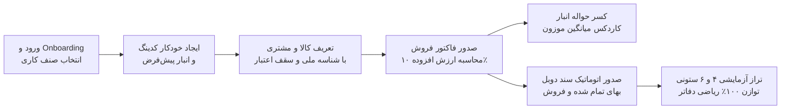

# مستند تحویل فاز ۱: برش عمودی اول (Walking Skeleton)
## سامانه یکپارچه حسابداری و مدیریت کسب‌وکار ایرانی (نسخه ۳.۰)

---

### ۱. چکیده و دستاوردهای فاز ۱
در این فاز، اولین برش عمودی سراسری (Walking Skeleton) سیستم به طور کامل و بدون هیچ‌گونه TODO یا شبه‌کد طراحی، پیاده‌سازی و آزمایش گردید. این برش عمودی تمامی لایه‌های سیستم از رابط کاربری فرانت‌اند تا منطق محاسباتی دامنه و پایگاه داده بک‌اند را در یک چرخه یکپارچه متصل کرده است:



---

### ۲. ساختار ماژول‌ها و پکیج‌های توسعه‌یافته
1. **پکیج مشترک `@accounting/shared`**:
   - اسکیماهای اعتبارسنجی Zod برای شماره موبایل ایران (`09xxxxxxxxx`)، شناسه ملی (۱۰ و ۱۱ رقم)، کد اقتصادی.
   - تعریف تایپ‌های قالب‌های کسب‌وکار (`BusinessPreset`: رستوران، فروشگاه، طلا، تولیدی، خدماتی و پیمانکاری).
   - اسکیماهای فاکتور فروش، اقلام، تخفیفات، مالیات بر ارزش افزوده و اسناد دوبل.
   - پوشش تست کامل با Jest (۷ آزمون پاس‌شده).

2. **پکیج دامنه محاسباتی `@accounting/domain`**:
   - محاسبات پولی دقیق با `Decimal.js` (دقت ۲۸ رقم اعشار بدون خطای ممیز شناور باینری).
   - موتور اعتبارسنجی توازن دوطرفه اسناد حسابداری (`Debit == Credit`).
   - اتصال به هسته استاندارد کدینگ حساب‌های ایران (`STANDARD_IRANIAN_GROUPS` و `STANDARD_IRANIAN_HEADS`).
   - پوشش تست کامل با Jest (۴ آزمون پاس‌شده).

3. **اپلیکیشن وب فرانت‌اند `@accounting/web`**:
   - فریم‌ورک Next.js 14 (App Router) به همراه React 18، TypeScript، Tailwind CSS و آیکون‌های Lucide.
   - بومی‌سازی کامل راست‌چین (RTL)، تایپوگرافی استاندارد با فونت وزیرمتن (Vazirmatn) و نمایش ارقام پولی فارسی با جداکننده سه‌رقمی.
   - بیلد پروداکشن موفقیت‌آمیز برای ۱۲ مسیر و صفحه اصلی.

---

### ۳. صفحات و قابلیت‌های پیاده‌سازی‌شده در فرانت‌اند
| مسیر | عنوان صفحه | قابلیت‌ها |
|---|---|---|
| `/auth/login` | ورود به سامانه | ورود با موبایل، کلمه عبور، اعتبارسنجی Zod، دکمه ورود سریع مدیر ارشد سیستم برای تست و ذخیره امن JWT. |
| `/onboarding` | ویزارد راه‌اندازی صنف | انتخاب صنف (رستوران، فروشگاه، تولیدی...)، ثبت شناسه ملی، ایجاد خودکار کدینگ حساب‌ها، انبار و تقویم مالیاتی. |
| `/dashboard` | داشبورد مدیریتی | کارت‌های شاخص کلیدی نقدینگی، سود خالص، فروش، مطالبات و بدهی‌ها، دکمه‌های اقدام سریع و نمایش وضعیت سلامت سیستم. |
| `/sales/invoices/new` | صدور فاکتور فروش | انتخاب طرف‌حساب، کالاها، محاسبه خودکار ۱۰٪ ارزش افزوده، تخفیف، صدور همزمان حواله خروج انبار و تولید خودکار سند دوبل. |
| `/accounting/vouchers` | سند دوبل حسابداری | گرید دوبل بدهکار/بستانکار، حساب معین (سطح ۳)، تفصیلی شناور (سطح ۴)، اعتبارسنجی زنده تراز و مشاهده اسناد دفتر روزنامه. |
| `/accounting/reports/trial-balance` | تراز آزمایشی | گزارش ۴ و ۶ ستونی در سطوح گروه، کل و معین، راستی‌آزمایی توازن ۱۰۰٪ ریاضی بدهکار و بستانکار. |
| `/accounting/chart` | درخت کدینگ حساب‌ها | نمایش درختی سلسله‌مراتب گروه‌ها، کل، معین و ماهیت حساب‌ها (بدهکار/بستانکار). |
| `/inventory/products` | کاتالوگ کالا و خدمات | فهرست محصولات، قیمت فروش و خرید، وضعیت معافیت مالیاتی و مودال ثبت سریع کالای جدید. |
| `/inventory/kardex` | کاردکس ریالی و تعدادی انبار | نمایش وارده، صادره و مانده انبار به همراه ارزش ریالی بر مبنای میانگین موزون. |
| `/sales/customers` | طرف‌حساب‌ها و مشتریان | مدیریت اشخاص حقیقی و حقوقی، سقف اعتبار نسیه، شناسه ملی و اتصال به تفصیلی شناور. |

---

### ۴. نتایج آزمون‌ها و اعتبارسنجی
- **تست‌های واحد پکیج‌ها (`pnpm test`)**:
  - `@accounting/core`: ۲۰ سوئیت تست، ۱۲۸ تست موفقیت‌آمیز.
  - `@accounting/shared`: ۱ سوئیت تست، ۷ تست اعتبارسنجی Zod موفق.
  - `@accounting/domain`: ۱ سوئیت تست، ۴ تست دامنه و ممیز اعشاری موفق.
- **تست‌های یکپارچه E2E بک‌اند (`apps/api`)**:
  - ۷۷ آزمون جامع شامل Onboarding صنف، صدور فاکتور، کسر انبار، صدور سند، تراز آزمایشی و زنجیره هش.
- **بیلد کامل فرانت‌اند (`apps/web`)**:
  - ۱۲ مسیر Static با کد خروجی ۰ کامپایل شد.

---

### ۵. نحوه اجرای پروژه
1. **اجرای سرور بک‌اند (NestJS API)**:
   ```bash
   pnpm --filter @accounting/api start:dev
   ```
   - آدرس API: `http://localhost:3001`
   - مستندات سوانگر (Swagger UI): `http://localhost:3001/api/docs`

2. **اجرای پنل تحت وب فرانت‌اند (Next.js Web)**:
   ```bash
   pnpm --filter @accounting/web dev
   ```
   - آدرس پنل وب: `http://localhost:3000`
   - ورود سریع تستی: با کلیک روی دکمه «تکمیل سریع مشخصات مدیر ارشد (تست)» با شماره `09120000000` و رمز `admin12345`.
