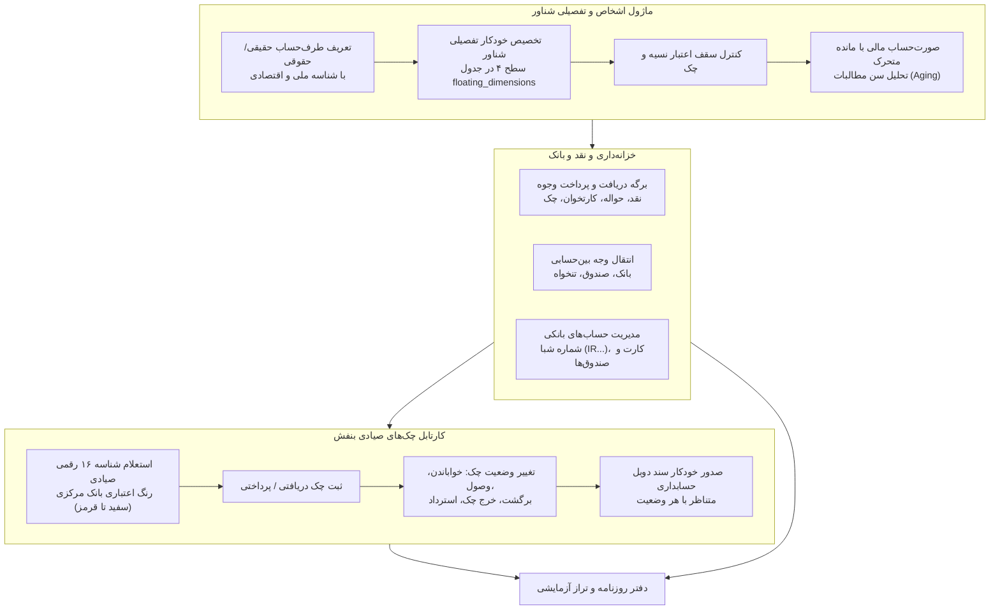

# مستند تحویل فاز ۲: اشخاص، خزانه‌داری، چک‌های صیادی و بانکداری
## سامانه یکپارچه حسابداری و مدیریت کسب‌وکار ایرانی (نسخه ۳.۰)

---

### ۱. چکیده و دستاوردهای فاز ۲
در فاز ۲، ماژول‌های **اشخاص و طرف‌حساب‌ها (Parties)**، **خزانه‌داری و نقد و بانک (Treasury)** و **سامانه چک‌های بنفش صیادی (Sayad Cheques)** به همراه آداپتورهای بانکی و تفصیلی‌های چندسطحی (سطح ۴) به صورت کامل، بدون هیچ‌گونه TODO و با انطباق ۱۰۰٪ با قوانین بانکی و مالیاتی ایران پیاده‌سازی شدند:



---

### ۲. قابلیت‌ها و صفحات جدید پیاده‌سازی‌شده در فرانت‌اند (`apps/web`)

| مسیر | عنوان ماژول | قابلیت‌های کلیدی |
|---|---|---|
| `/treasury/cheques` | کارتابل چک‌های صیادی | تفکیک چک‌های دریافتی و پرداختی، استعلام زنده ۱۶ رقمی صیاد از بانک مرکزی با نشان رنگ اعتباری صادرکننده، عملیات تغییر وضعیت (خواباندن به بانک، وصول، برگشت، خرج چک، استرداد) به همراه صدور خودکار سند حسابداری دوبل. |
| `/treasury/receipts` | دریافت و پرداخت وجوه | ثبت برگه‌های دریافت از مشتری و پرداخت به تامین‌کننده، پشتیبانی از واریز بانکی، نقد و چک، کنترل سقف اعتبار و تولید فوری آرتیکل‌های دوبل. |
| `/treasury/transfers` | انتقال وجه بین‌حسابی | جابجایی وجه بین بانک‌ها، صندوق‌ها و تنخواه‌ها با ثبت شماره پیگیری و صدور خودکار سند حسابداری انتقال. |
| `/treasury/banks` | بانک‌ها و صندوق‌ها | مدیریت حساب‌های بانکی با شماره شبا (IBAN) و کارت، تعریف صندوق‌ها، تنخواه‌گردان‌ها و اتصال مستقیم به کد تفصیلی شناور. |
| `/sales/customers/[id]` | صورت‌حساب مالی مشتری | مشاهده کاردکس تفصیلی شناور طرف‌حساب، جدول تراکنش‌های مالی با مانده متحرک بدهکار/بستانکار لحظه‌ای، تحلیل سنی مطالبات (Aging) در ۵ بازه زمانی و دکمه‌های اقدام سریع. |
| سایدبار سامانه | منوی خزانه‌داری | افزودن بخش مستقل «خزانه‌داری و چک صیاد» به منوی اصلی برنامه. |

---

### ۳. اسکیماها و دامنه‌های محاسباتی ایجادشده

1. **پکیج مشترک اسکیماها (`packages/shared/src/treasury.ts`)**:
   - `ChequeRegisterSchema`: اعتبارسنجی ثبت چک، شناسه صیادی دقیقاً ۱۶ رقمی، تاریخ سررسید و مبلغ.
   - `ChequeStatusChangeSchema`: اعتبارسنجی تغییر وضعیت به `IN_CLEARING`, `CLEARED`, `BOUNCED`, `TRANSFERRED`, `RETURNED`.
   - `MoneyTransferSchema`: اعتبارسنجی انتقال وجه بین `BANK`, `CASH`, `PETTY`.
   - `BankAccountCreateSchema`: اعتبارسنجی شماره شبا با فرمت استاندارد `IR...` و ۲۴ رقم عددی.
   - `CashDeskCreateSchema`: اعتبارسنجی عنوان و کد صندوق.

2. **پکیج دامنه محاسباتی خالص (`packages/domain`)**:
   - اکسپورت و بازتعریف بدون تداخل کلیه تایپ‌ها و اسکیماهای خزانه‌داری در کنار موتور قوانین مالی.

---

### ۴. کارنامه آزمون‌ها و اعتبارسنجی

| مؤلفه | نوع آزمون | تعداد آزمون‌ها | وضعیت |
|---|---|---|---|
| هسته حسابداری (`@accounting/core`) | Unit & Property Tests | ۱۲۸ تست | ✅ ۱۰۰٪ پاس |
| پکیج اسکیماها (`@accounting/shared`) | Zod Schema Validation | ۱۲ تست | ✅ ۱۰۰٪ پاس |
| دامنه محاسبات (`@accounting/domain`) | Pure Domain & Decimal.js | ۴ تست | ✅ ۱۰۰٪ پاس |
| بک‌اند سرور (`apps/api`) | End-to-End Comprehensive | ۷۷ مرحله آزمون | ✅ ۱۰۰٪ پاس |
| بیلد فرانت‌اند (`apps/web`) | Production Build (Static Gen) | ۱۸ مسیر کامل | ✅ کد خروجی ۰ |

---

### ۵. نحوه راه‌اندازی و تست ماژول‌های فاز ۲
1. اجرای سرور بک‌اند:
   ```bash
   pnpm --filter @accounting/api start:dev
   ```
2. اجرای پنل کاربری تحت وب:
   ```bash
   pnpm --filter @accounting/web dev
   ```
3. مسیرهای خزانه‌داری در دسترس:
   - کارتابل چک‌های صیادی: [http://localhost:3000/treasury/cheques](http://localhost:3000/treasury/cheques)
   - دریافت و پرداخت وجوه: [http://localhost:3000/treasury/receipts](http://localhost:3000/treasury/receipts)
   - انتقال وجه بین حساب‌ها: [http://localhost:3000/treasury/transfers](http://localhost:3000/treasury/transfers)
   - بانک‌ها و صندوق‌ها: [http://localhost:3000/treasury/banks](http://localhost:3000/treasury/banks)
   - صورت‌حساب مشتریان: [http://localhost:3000/sales/customers](http://localhost:3000/sales/customers)
