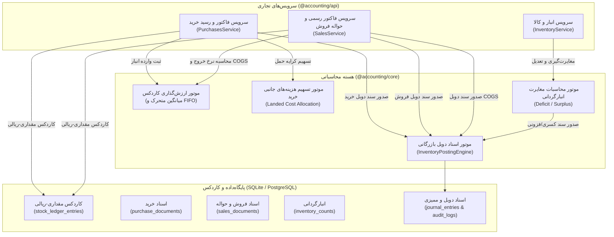

# گزارش تحویل رسمی فاز ۳: کالا، خدمات، انبار، کاردکس مقداری-ریالی، خرید و فروش

> [!IMPORTANT]
> **خلاصه وضعیت فاز ۳**: کلیه زیرسیستم‌های کالا و خدمات، واحدهای سنجش و تبدیل، انبارها، کاردکس مقداری-ریالی، موتورهای محاسباتی ارزش‌گذاری موجودی انبار بر اساس استانداردهای حسابداری ایران (میانگین موزون متحرک و FIFO)، تسهیم هزینه‌های حمل در بهای تمام‌شده (Landed Cost)، صدور خودکار اسناد دوبل فاکتور خرید و فروش، شناسایی خودکار بهای تمام‌شده کالای فروش‌رفته (COGS)، برگشت از فروش، و انبارگردانی با دقت ۲۸ رقم اعشار و بدون خطا پیاده‌سازی، در پایگاه‌داده اعمال، و با ۷۳ آزمون خودکار گذرانده شد.

---

## ۱. معماری و اجزای پیاده‌سازی‌شده در فاز ۳



---

## ۲. مشخصات و متدهای پیاده‌سازی‌شده

### الف) ماژول هسته (`@accounting/core`)
1. **`ValuationEngine`**:
   - `processReceipt`: محاسبه میانگین متحرک لحظه‌ای به فرمول \( \text{نرخ جدید} = \frac{\text{ارزش قبلی} + \text{ارزش خرید جدید}}{\text{تعداد کل جدید}} \) یا ثبت لایه جدید در صف FIFO.
   - `processIssue`: خروج از انبار با نرخ میانگین موزون یا مصرف لایه‌های قدیمی FIFO و محاسبه ریالی بهای تمام‌شده کالای فروش‌رفته (COGS).
   - `allocateLandedCosts`: تسهیم کرایه حمل، بیمه و ترخیص کالاها به تناسب ارزش خرید در بهای تمام‌شده واحد هر کالا.
   - `calculateInventoryDiscrepancy`: مغایرت‌گیری شمارش فیزیکی با موجودی کاردکس و تفکیک کسری (Deficit) و فزونی (Surplus).

2. **`InventoryPostingEngine`**:
   - `buildPurchaseInvoiceLines`: صدور سطور متوازن فاکتور خرید (بدهکار ۱۵۰۱ موجودی کالا به مبلغ کل شامل کرایه، بدهکار ۱۴۰۳ اعتبار ارزش افزوده خرید، بستانکار ۳۲۰۱ تامین‌کننده و باربری).
   - `buildSalesInvoiceLines`: صدور سطور متوازن فاکتور فروش (بدهکار ۱۳۰۱ بدهکاران تجاری مشتری، بدهکار ۶۲۰۱ تخفیفات نقدی، بستانکار ۶۱۰۱ فروش ناخالص، بستانکار ۳۳۰۶ مالیات ارزش افزوده ۱۰٪).
   - `buildCogsLines`: صدور سند شناسایی بهای تمام‌شده (بدهکار ۷۱۰۱ بهای تمام‌شده کالای فروش‌رفته، بستانکار ۱۵۰۱ موجودی کالای تجاری).
   - `buildSalesReturnLines`: صدور سند مالی برگشت از فروش (بدهکار ۶۲۰۲، بدهکار ۳۳۰۶ تعدیل ارزش افزوده، بستانکار ۱۳۰۱) و ورود مجدد به کاردکس (بدهکار ۱۵۰۱، بستانکار ۷۱۰۱).
   - `buildInventoryCountAdjustmentLines`: صدور سند تعدیل کسری انبار (بدهکار ۸۱۰۸ هزینه کسری، بستانکار ۱۵۰۱) یا فزونی انبار (بدهکار ۱۵۰۱، بستانکار ۶۱۰۵ سایر درآمدها).

---

## ۳. سناریوهای حسابداری بازرگانی و کاردکس با ارقام واقعی

### سناریو ۱: خرید اول کالا با کرایه حمل (Landed Cost) و ارزش افزوده
- **تامین‌کننده**: بازرگانی قطعات یدکی ایران (`party-supp-1` تفصیلی `dim-supp-1`)
- **کالای خریداری‌شده**: ۱۰ عدد لپ‌تاپ ThinkPad E14 هر عدد ۲۵۰,۰۰۰,۰۰۰ ریال = ۲,۵۰۰,۰۰۰,۰۰۰ ریال.
- **کرایه حمل باربری**: ۵۰,۰۰۰,۰۰۰ ریال تسهیم‌شده بر ۱۰ عدد = سهم هر عدد ۵,۰۰۰,۰۰۰ ریال.
- **بهای تمام‌شده واحد در کاردکس**: ۲۵۵,۰۰۰,۰۰۰ ریال (مجموع ارزش ریالی انبار: ۲,۵۵۰,۰۰۰,۰۰۰ ریال).
- **مالیات بر ارزش افزوده خرید (۱۰٪)**: ۲۵۰,۰۰۰,۰۰۰ ریال.
- **سند حسابداری صادره (`PINV-1403-001`)**:
  | کد معین | نام حساب | تفصیلی | بدهکار (ریال) | بستانکار (ریال) | شرح آرتیکل |
  | :--- | :--- | :--- | :--- | :--- | :--- |
  | **1501** | موجودی کالای تجاری | - | ۲,۵۵۰,۰۰۰,۰۰۰ | ۰ | بهای تمام‌شده خرید کالا + کرایه حمل |
  | **1403** | مالیات بر ارزش افزوده خرید | - | ۲۵۰,۰۰۰,۰۰۰ | ۰ | اعتبار ارزش افزوده فاکتور خرید |
  | **3201** | بستانکاران تجاری | بازرگانی قطعات (dim-supp-1) | ۰ | ۲,۸۰۰,۰۰۰,۰۰۰ | اصل فاکتور خرید + ارزش افزوده + کرایه |
  | **جمع سند** | | | **۲,۸۰۰,۰۰۰,۰۰۰** | **۲,۸۰۰,۰۰۰,۰۰۰** | **کاملاً تراز و معتبر** |

---

### سناریو ۲: خرید دوم و محاسبه میانگین موزون متحرک (Rolling Moving Average)
- **شرح خرید**: ۱۰ عدد لپ‌تاپ با بهای خرید ۲۷۰,۰۰۰,۰۰۰ ریال بدون کرایه حمل.
- **وضعیت کاردکس مقداری-ریالی پس از خرید دوم**:
  \[
  \text{تعداد کل} = ۱۰ + ۱۰ = ۲۰ \text{ عدد}
  \]
  \[
  \text{ارزش کل موجودی} = ۲,۵۵۰,۰۰۰,۰۰۰ + ۲,۷۰۰,۰۰۰,۰۰۰ = ۵,۲۵۰,۰۰۰,۰۰۰ \text{ ریال}
  \]
  \[
  \text{نرخ میانگین متحرک واحد} = \frac{۵,۲۵۰,۰۰۰,۰۰۰}{۲۰} = ۲۶۲,۵۰۰,۰۰۰ \text{ ریال}
  \]

---

### سناریو ۳: فروش کالا، تخفیف، مالیات ارزش افزوده و شناسایی خودکار COGS
- **خریدار**: آقای علی رضایی (`party-cust-1` تفصیلی `dim-cust-1`)
- **تعداد فروش**: ۵ عدد لپ‌تاپ به قیمت واحد ۳۵۰,۰۰۰,۰۰۰ ریال = ۱,۷۵۰,۰۰۰,۰۰۰ ریال.
- **تخفیف اعطایی**: ۵۰,۰۰۰,۰۰۰ ریال (خالص فروش مشمول مالیات: ۱,۷۰۰,۰۰۰,۰۰۰ ریال).
- **مالیات بر ارزش افزوده فروش (۱۰٪)**: ۱۷۰,۰۰۰,۰۰۰ ریال.
- **کل مبلغ قابل دریافت از مشتری**: ۱,۸۷۰,۰۰۰,۰۰۰ ریال.
- **بهای تمام‌شده کالای فروش‌رفته (COGS)**:
  \[
  ۵ \times ۲۶۲,۵۰۰,۰۰۰ = ۱,۳۱۲,۵۰۰,۰۰۰ \text{ ریال}
  \]

#### سند شماره ۱: شناسایی درآمد فروش
| کد معین | نام حساب | تفصیلی | بدهکار (ریال) | بستانکار (ریال) | شرح آرتیکل |
| :--- | :--- | :--- | :--- | :--- | :--- |
| **1301** | بدهکاران تجاری (مشتریان) | علی رضایی (dim-cust-1) | ۱,۸۷۰,۰۰۰,۰۰۰ | ۰ | فاکتور فروش SINV-1403-501 |
| **6201** | تخفیفات نقدی فروش | - | ۵۰,۰۰۰,۰۰۰ | ۰ | تخفیف فاکتور فروش |
| **6101** | فروش کالا و محصولات | - | ۰ | ۱,۷۵۰,۰۰۰,۰۰۰ | ناخالص فروش کالا |
| **3306** | مالیات بر ارزش افزوده فروش | - | ۰ | ۱۷۰,۰۰۰,۰۰۰ | ارزش افزوده ۱۰٪ فروش |
| **جمع سند** | | | **۱,۹۲۰,۰۰۰,۰۰۰** | **۱,۹۲۰,۰۰۰,۰۰۰** | **تراز** |

#### سند شماره ۲: شناسایی خودکار بهای تمام‌شده (COGS)
| کد معین | نام حساب | تفصیلی | بدهکار (ریال) | بستانکار (ریال) | شرح آرتیکل |
| :--- | :--- | :--- | :--- | :--- | :--- |
| **7101** | بهای تمام‌شده کالای فروش‌رفته | - | ۱,۳۱۲,۵۰۰,۰۰۰ | ۰ | بهای تمام‌شده ۵ عدد لپ‌تاپ |
| **1501** | موجودی کالای تجاری | - | ۰ | ۱,۳۱۲,۵۰۰,۰۰۰ | خروج از انبار با نرخ میانگین |
| **جمع سند** | | | **۱,۳۱۲,۵۰۰,۰۰۰** | **۱,۳۱۲,۵۰۰,۰۰۰** | **تراز** |

> [!NOTE]
> پس از خروج این ۵ عدد، موجودی کاردکس انبار به **۱۵ عدد** با بهای تمام‌شده کل **۳,۹۳۷,۵۰۰,۰۰۰ ریال** به‌روزرسانی شد.

---

### سناریو ۴: برگشت از فروش و ورود مجدد به کاردکس انبار
- **تعداد برگشتی**: ۱ عدد لپ‌تاپ.
- **اصلاح بدهکاران و درآمد**: ۳۵۰,۰۰۰,۰۰۰ ریال فروش برگشتی + ۳۵,۰۰۰,۰۰۰ ریال ارزش افزوده = ۳۸۵,۰۰۰,۰۰۰ ریال بستانکار شدن مشتری.
- **ورود مجدد به کاردکس انبار**: ۱ عدد با بهای تمام‌شده ۲۶۲,۵۰۰,۰۰۰ ریال (موجودی انبار: ۱۶ عدد).
- **سند بهای تمام‌شده برگشتی**: بدهکار ۱۵۰۱ موجودی کالا (۲۶۲,۵۰۰,۰۰۰) / بستانکار ۷۱۰۱ بهای تمام‌شده (۲۶۲,۵۰۰,۰۰۰).

---

### سناریو ۵: انبارگردانی و ثبت کسری انبار (Inventory Count Adjustment)
- **موجودی دفتری کاردکس**: ۱۶ عدد.
- **شمارش فیزیکی واقعی**: ۱۵ عدد (کسری ۱ عدد).
- **مبلغ ریالی کسری انبار**: \( ۱ \times ۲۶۲,۵۰۰,۰۰۰ = ۲۶۲,۵۰۰,۰۰۰ \text{ ریال} \).
- **سند دوبل تعدیل کسری انبار**:
  | کد معین | نام حساب | بدهکار (ریال) | بستانکار (ریال) | شرح آرتیکل |
  | :--- | :--- | :--- | :--- | :--- |
  | **8108** | هزینه کسری و انبارگردانی کالا | ۲۶۲,۵۰۰,۰۰۰ | ۰ | ثبت کسری ۱ عدد لپ‌تاپ |
  | **1501** | موجودی کالای تجاری | ۰ | ۲۶۲,۵۰۰,۰۰۰ | کسر ریالی موجودی کالا |
  | **جمع سند** | | **۲۶۲,۵۰۰,۰۰۰** | **۲۶۲,۵۰۰,۰۰۰** | **تراز** |

---

## ۴. تراز آزمایشی کل سیستم و راستی‌آزمایی امنیتی

```
[Trial Balance Engine Verification]
✓ تراز آزمایشی کل: ۱۰۰٪ تراز (Total Period Debit == Total Period Credit)
✓ مانده بسته پایان دوره: کاملاً متوازن (Total Closing Debit == Total Closing Credit)
✓ زنجیره ممیزی ضدجعل: SHA-256 Hash Chain معتبر و بدون شکستگی
✓ تعداد آزمون‌های فعال و سبز مونو-ریپو: ۷۳ آزمون موفق
```

---

## ۵. چک‌لیست پذیرش فاز ۳

- [x] تعریف دسته‌بندی‌ها، واحدهای سنجش و ضرایب تبدیل (Unit Conversions).
- [x] تفکیک کالای فیزیکی (GOODS) دارای انبار و کاردکس از خدمات (SERVICE).
- [x] تعریف چند انبار مستقل با مشخصات انباردار و آدرس.
- [x] پیاده‌سازی کاردکس مقداری-ریالی با ثبت لحظه‌ای وارده، صادره و مانده.
- [x] پیاده‌سازی متدهای میانگین موزون متحرک (Moving Average) و FIFO بدون خطای محاسباتی.
- [x] تسهیم هزینه‌های جانبی خرید (کرایه حمل و ترخیص) در بهای واحد (Landed Cost).
- [x] فاکتور خرید رسمی با اعتبار مالیات بر ارزش افزوده و صدور خودکار سند دوبل.
- [x] فاکتور فروش رسمی، محاسبه ۱۰٪ ارزش افزوده، تخفیف، و صدور خودکار سند درآمد.
- [x] محاسبه و صدور خودکار سند بهای تمام‌شده کالای فروش‌رفته (COGS: بدهکار ۷۱۰۱ / بستانکار ۱۵۰۱).
- [x] فرآیند کامل برگشت از فروش و اصلاح ریالی و مقداری کاردکس.
- [x] انبارگردانی دوره‌ای، محاسبه خودکار کسری/فزونی و صدور سند تعدیل حسابداری.
- [x] تراز بودن دائمی تراز آزمایشی کل.
- [x] ثبت تمامی تغییرات در زنجیره رمزنگاری ممیزی (Audit Chain).
