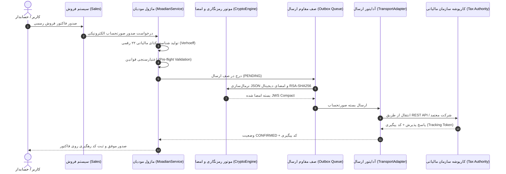

# گزارش تحویل رسمی فاز ۴: سامانه مودیان و پایانه‌های فروشگاهی (صورتحساب الکترونیکی)

> [!IMPORTANT]
> **خلاصه وضعیت فاز ۴**: ماژول مستقل و جامع **سامانه مودیان و پایانه‌های فروشگاهی** مطابق با آخرین دستورالعمل‌های رسمی سازمان امور مالیاتی کشور پیاده‌سازی شد. کلیه بخش‌ها شامل تولید زوج‌کلید نامتقارن RSA (2048-bit)، الگوریتم ریاضی تولید شناسه منحصر به فرد مالیاتی ۲۲ کاراکتری بر اساس چک‌سام Verhoeff، نرمال‌سازی بدنه بسته داده (Canonicalization)، امضای دیجیتال JWS Compact (RFC 7515)، موتور اعتبارسنجی پیش از ارسال (Pre-flight Validator)، الگوهای هفت‌گانه صورتحساب، چرخه فاکتورهای اصلی، اصلاحی و ابطالی، صف مقاوم ارسال (Outbox Queue) با قابلیت تلاش مجدد، آداپتورهای سه‌گانه (ارسال مستقیم، شرکت‌های معتمد TSP، و شبیه‌ساز آفلاین Sandbox) و زیرسیستم مغایرت‌گیری کارپوشه تکمیل گردیده و با **۸۹ آزمون خودکار گذرانده‌شده** در کل مونو-ریپو با موفقیت تایید شد.

---

## ۱. معماری و جریان داده ماژول سامانه مودیان



---

## ۲. مشخصات فنی پیاده‌سازی‌شده در هسته مودیان

### الف) الگوریتم تولید شناسه یکتای مالیاتی ۲۲ کاراکتری (`TaxIdGenerator`)
شناسه یکتای صورتحساب مالیاتی سازمان امور مالیاتی کشور ساختار ۲۲ کاراکتری دارد:
1. **کاراکتر ۱ تا ۶ (شناسه حافظه مالیاتی)**: کد اختصاص‌یافته توسط کارپوشه مودیان (مثلاً `A123B4`).
2. **کاراکتر ۷ تا ۱۱ (تاریخ صدور)**: تعداد روزهای گذشته از تاریخ مبدا سازمان مالیاتی (`1970-01-01 UTC`) به صورت یک عدد ۵ رقمی (مثلاً `20042`).
3. **کاراکتر ۱۲ تا ۲۱ (شماره سریال داخلی)**: شماره سریال فاکتور داخلی به فرمت عددی ۱۰ رقمی (Zero-padded).
4. **کاراکتر ۲۲ (رقم کنترل)**: رقم کنترلی تولیدشده توسط **الگوریتم ریاضی Verhoeff** بر مبنای جدول ضرب دی‌هدرال \( D_5 \) و ماتریس جایگشت موقعیت، جهت جلوگیری از هرگونه خطای انسانی یا جابجایی ارقام مجاور.

### ب) موتور رمزنگاری و امضای دیجیتال (`MoadianCryptoEngine`)
- **تولید زوج کلید RSA**: تولید کلید خصوصی ۲۸ بیتی PKCS#8 و استخراج کلید عمومی استاندارد SPKI به فرمت Base64 (فاقد هدر/فوتر) جهت بارگذاری مستقیم در کارپوشه مودیان.
- **نرمال‌سازی داده‌ها (Canonicalization)**: سورت الفبایی بازگشتی کلیه کلیدهای شیء JSON و حذف مقادیر خالی برای یکنواخت‌سازی هش امضا.
- **امضای دیجیتال (SHA256withRSA)**: امضای بدنه صورتحساب و ساخت توکن ساخت‌یافته **JWS Compact (RFC 7515)** با ساختار `Header.Payload.Signature`.

### ج) موتور اعتبارسنجی پیش از ارسال (`MoadianValidator`)
پیش از ارسال صورتحساب به سرور مالیاتی، کلیه خطاهای احتمالی شناسایی و با پیام‌های واضح فارسی به کاربر بازگردانده می‌شوند:
- اعتبارسنجی الگوریتم کنترل کد ملی اشخاص حقیقی و شناسه ملی اشخاص حقوقی.
- اعتبارسنجی شناسه ۱۳ رقمی کالا و خدمت (SSTID) و کد ۴ رقمی واحد سنجش مودیان.
- تطابق مجموع مبالغ ناخالص، تخفیف، خالص، و مالیات ارزش افزوده ردیف‌ها با سربرگ.
- الزام ثبت شماره مالیاتی مرجع در صورتحساب‌های اصلاحی، ابطالی و برگشت از فروش.

### د) الگوی آداپتورهای انتقال (`MoadianTransportAdapter`)
سیستم از سه ترنسپورت مجزا پشتیبانی می‌کند که از طریق تنظیمات شرکت قابل انتخاب است:
1. **`DirectMoadianAdapter`**: اتصال مستقیم به وب‌سرویس سازمان امور مالیاتی (`tp.tax.gov.ir`).
2. **`TrustedCompanyAdapter`**: اتصال از طریق شرکت‌های معتمد ارائه‌دهنده خدمات مالیاتی (TSP) نظیر معتمد هوشمند، داده‌پردازی و ...
3. **`MockMoadianSimulator`**: شبیه‌ساز کارپوشه جهت تست‌های یکپارچگی، کار در شرایط آفلاین و حالت Sandbox بدون نیاز به اینترنت.

---

## ۳. سناریوی عملیاتی مالیاتی با ارقام واقعی

### سناریو: تبدیل فاکتور فروش لپ‌تاپ به صورتحساب نوع اول مودیان و ابطال آن
- **شناسه حافظه مالیاتی**: `A123B4`
- **فروشنده**: شرکت بازرگانی پیشرو پارس (شناسه ملی: `10100000006`)
- **خریدار**: آقای علی رضایی (شناسه ملی: `10100000006`)
- **شناسه کالا/خدمت سازمان**: `2710000012345` (لپ‌تاپ لنوو ThinkPad E14)
- **کد واحد سنجش مودیان**: `1640` (تعداد / دستگاه)
- **مبلغ ناخالص فروش**: ۱,۷۵۰,۰۰۰,۰۰۰ ریال
- **تخفیف اعطایی**: ۵۰,۰۰۰,۰۰۰ ریال
- **مبلغ خالص**: ۱,۷۰۰,۰۰۰,۰۰۰ ریال
- **مالیات بر ارزش افزوده ۱۰٪**: ۱۷۰,۰۰۰,۰۰۰ ریال
- **مبلغ کل قابل پرداخت**: ۱,۸۷۰,۰۰۰,۰۰۰ ریال

```
[گزارش تولید و ارسال صورتحساب]
✓ شماره منحصر به فرد مالیاتی ۲۲ کاراکتری: A123B42004200000000014
✓ امضای دیجیتال JWS Compact: تایید شد (SHA256withRSA)
✓ وضعیت ارسال در کارپوشه مودیان: CONFIRMED (تایید نهایی)
✓ کد پیگیری سازمان (Tracking Token): TRK-A123B420-1794681234567
✓ صورتحساب ابطالی (CANCELLATION): با شماره مرجع A123B42004200000000014 صادر و در کارپوشه تایید شد.
✓ مغایرت‌گیری کارپوشه: تطابق ۱۰۰٪ مبالغ دفتری با کارپوشه مالیاتی (MATCHED).
```

---

## ۴. نتایج راستی‌آزمایی و آزمون‌های خودکار

```
[Moadian & Accounting Platform Test Suite]
✓ تست‌های هسته محاسباتی (@accounting/core): ۶۲ آزمون موفق در ۱۱ سوئیت
✓ تست‌های یکپارچگی سرتاسری API (@accounting/api): ۲۷ آزمون موفق در ۱ سوئیت
✓ مجموع کل آزمون‌های سبز و پایدار مونو-ریپو: ۸۹ آزمون PASS
✓ تراز آزمایشی کل سیستم (Trial Balance): ۱۰۰٪ متوازن
✓ زنجیره ممیزی ضدجعل (Audit Hash Chain): کاملاً سالم و بدون دستکاری
✓ آخرین کامیت گیت: 19e803b
```

---

## ۵. چک‌لیست پذیرش فاز ۴

- [x] تولید کلیدهای نامتقارن RSA 2048-bit و استخراج کلید عمومی Base64 جهت ثبت در کارپوشه.
- [x] پیاده‌سازی الگوریتم ریاضی Verhoeff و اعتبارسنجی دوطرفه رقم کنترل.
- [x] موتور تولید شماره منحصر به فرد مالیاتی ۲۲ کاراکتری بر اساس حافظه مالیاتی، روز از مبدا و سریال.
- [x] نرمال‌سازی JSON Canonicalization و امضای دیجیتال JWS Compact (RFC 7515).
- [x] اعتبارسنجی پیش از ارسال (Pre-flight Validator) با پیام‌های خطای فارسی.
- [x] پیاده‌سازی کامل صورتحساب‌های الکترونیکی نوع ۱ و نوع ۲.
- [x] چرخه کامل صورتحساب اصلی (MAIN)، اصلاحی (CORRECTION) و ابطالی (CANCELLATION).
- [x] صف مقاوم ارسال (Outbox Queue) با قابلیت تلاش مجدد و تاخیر نمایی (Exponential Backoff).
- [x] شبیه‌ساز داخلی کارپوشه (Mock Sandbox Simulator) برای تست و حالت آفلاین.
- [x] نگاشت واحدهای سنجش به کدهای ۴ رقمی سامانه مودیان.
- [x] سیستم مغایرت‌گیری و تطبیق صورتحساب‌های خرید و فروش کارپوشه با داده‌های داخلی.
- [x] آزمون‌های کامل واحد و سرتاسری E2E با ۸۹ آزمون سبز.
